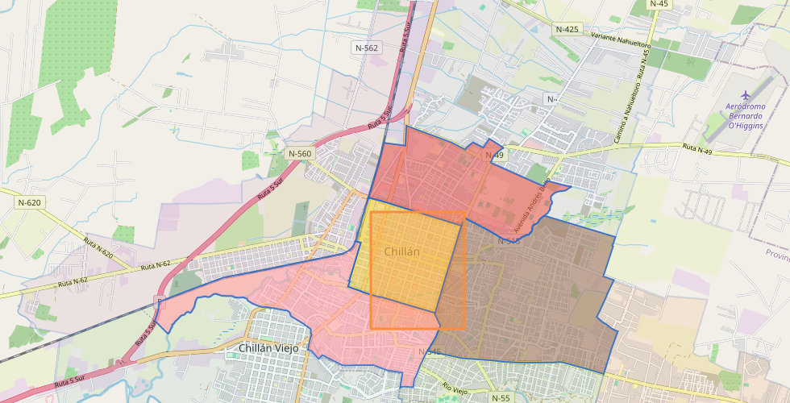

# Selección dibujada sin recargar geometría

La selección reutiliza las teselas cargadas y actualiza su opacidad mediante `feature-state`.

- Vía rápida: una consulta GIS por capa y dibujo, sin descargas MVT adicionales.
- Intersección exacta de geometrías completas; conserva clases, colores y opacidades.
- Requiere claves de selección del core GIS; ante desbordamiento utiliza teselas anotadas.

## Verificación manual
1. Activar una capa vectorial y configurar clases desde su editor.
2. Dibujar polígonos superpuestos y comprobar conteos, atenuación y una sola consulta de conteo.
3. Combinar un filtro de atributo, desplazar el mapa y borrar los dibujos; verificar el restablecimiento.

La captura corresponde al área cartográfica del entorno de integración; la tipografía de leyenda no forma parte de este cambio.
Mapa base: © OpenStreetMap contributors, https://www.openstreetmap.org/copyright.
